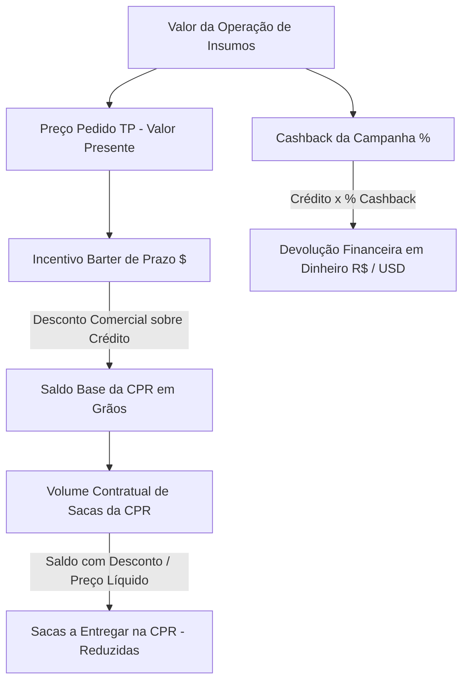

# PRD_SYDE-31 – Simulador de Taxas: Modalidade Barter (Nutrade)
## Documento de Evolução & Especificação Refinada (v1.7)

**Identificador:** PRD_SYDE-31 | **Card Jira:** SYDE-31 | **Referência Cruzada:** PRD_FIN-12453  
**Versão:** v1.7 (Refinamento de Engenharia, Governança de Produto e Contrato WSys)  
**Data:** 13 de outubro de 2026  
**Status Atual:** Pronto para Desenvolvimento (Ready for Dev)  
**Autor / Revisão:** Josue Jofre (Produto & Engenharia)  
**Aprovadores / Stakeholders:** Pablo (Diretoria de Produto), Alessandra Monteiro / Mariana Haddad (Mesa de Grãos Nutrade), Aleksander Santos (Engenharia Syde)  
**Documento Técnico Base da Integração:** `Wsys-API-Integracao-Precos-2026-10-13.pdf` (CTRM 2.10.1)

---

## 📋 1. Changelog do Documento

| Versão | Data | Autor / Origem | Principais Alterações |
|---|---|---|---|
| **v1.0** | 31/08/2026 | Produto & Negócio | Consolidação de regras após ata 21/08: separação entre Incentivo de Prazo (abate sacas) e Cashback (dinheiro), foco exclusivo em Barter Nutrade. |
| **v1.3** | 17/09/2026 | Produto | Inclusão de testes de mesa homologados e matriz de frete flexível. |
| **v1.6** | 06/10/2026 | Produto & Mesa de Grãos | Consolidação do alinhamento técnico de telas do WSys (descarte de web scraping, alertas CBOT, frete flexível). |
| **v1.7** | **13/10/2026** | **Produto & Engenharia** | **Refinamento Crítico de Contrato, Métricas e Governança:**<br>1. **Business Outcomes & KPIs:** Substituição de outputs funcionais por metas de negócio quantitativas (SMART) alinhadas com diretoria (Pablo).<br>2. **Feature Flags:** Inclusão formal de 4 flags para rollout seguro e Kill Switch contra instabilidades externas.<br>3. **Contrato Oficial WSys CTRM 2.10.1:** Atualização de rotas reais (`/api/integracao/odin/...`), remoção de `cityID`, exigência de `UF` e obrigatoriedade de `startDate`/`endDate` (evitando erro 500).<br>4. **Desacoplamento Fiscal:** Constatação da ausência de dados fiscais no WSys e especificação da Matriz/Cadastro de Impostos nativa no Syde conectada via código IBGE/UF.<br>5. **Conversão Cambial para Tributos (PTAX):** Substituição do cadastro estático de taxa cambial por consumo da **Cotação PTAX (BACEN)** para conversão de tributos estaduais em USD, com nota mandatória de validação junto ao time de Barter.<br>6. **Critérios de Aceite:** Inclusão de CAs dedicados para o Toggle Fiscal (CA-23), Fallback de Lote Vazio (CA-24) e Feature Flags (CA-25).<br>7. **Correção Estrutural:** Reordenação das Seções 12, 13 e 14. |

---

## 📌 2. Matriz De-Para das Evoluções do PRD

| Item / Seção | Estado Anterior (v1.6) | Novo Estado Refinado (v1.7) | Motivo / Justificativa Técnica |
|---|---|---|---|
| **Seção 3: Objetivos** | Apenas outputs funcionais ("permitir simulação", "exibir comparativo"). | **Business Outcomes** com foco em geração de receita, velocidade comercial e eliminação de erros na CPR. | Alinhamento com a diretoria de produto para comprovação de ROI e auditoria pós-lançamento. |
| **Métricas de Sucesso** | Inexistentes. | **KPIs SMART** quantitativos (Adoção >80% em 60d, Confiabilidade 0% de erro na CPR, Lead time < 2 min). | Critérios auditáveis para declarar o sucesso do lançamento. |
| **Feature Flags** | Ausente no documento. | **4 Feature Flags especificadas** (`ff_barter_nutrade_ui`, `ff_barter_wsys_integration`, `ff_barter_kill_switch`, `ff_barter_cbot_alert`). | Mitigação de risco operacional e dependência do WSys sem exigir deploys emergenciais. |
| **Origem dos Impostos** | Assumia consumo de tributos da API WSys (`/getPrices`). | **Motor Tributário Interno do Syde** alimentado por matriz hierárquica (UF/IBGE). | A API oficial WSys CTRM 2.10.1 **não possui nem retorna campos fiscais**. |
| **Conversão Cambial dos Tributos** | Omissa (presumia que tudo viria na moeda pelo WSys). | Adoção da **Cotação PTAX oficial do Banco Central** para converter tributos fixados em R$ (UPF/UFERMS) em simulações USD. | Não faz sentido cadastrar taxa cambial estática na campanha devido à alta volatilidade diária do dólar. **(Ponto registrado como pendente de validação com o time de Barter).** |
| **Tarifas de Frete por KM** | Assumia consumo de R$/KM do WSys. | **Parametrização no Cadastro de Campanha** do Syde. | O WSys precifica apenas o frete de rota cidade-porto. Não recebe nem calcula KM de fazenda flexível na query. |
| **Endpoints do WSys** | `/integracao/contrato/...` (rotas do Odin legadas). | `/api/integracao/odin/...` (rotas reais de produção da Syngenta). | Documento oficial WSys de 13/10/2026 retificou que as rotas antigas não existem. |
| **Filtros de Preço WSys** | Enviava `cityID`; sem `UF`, sem `DT_Vencto`. | Remove `cityID`; exige `city`, `UF`, `startDate`, `endDate` e `DT_Vencto`. | Quebra de contrato da API 2.10.1. A ausência de `startDate`/`endDate` causava erro 500 no WSys. |
| **Toggle Fiscal (RF-06)** | Apenas requisito descritivo sem critério de aceite. | **CA-23** formalizado: Default ligado; quando desligado zera valor; persiste no link e no PDF. | Evitar divergência de interpretação entre front e back. |
| **Estrutura das Seções** | Duplicidade da Seção 13 e inversão de títulos. | Reorganização: 12. Critérios de Aceite, 13. Matriz de Riscos, 14. Evidências. | Clareza e indexação com cards do Jira. |

---

## 🎯 3. Business Outcomes & Objetivos de Negócio

O objetivo do projeto não é apenas disponibilizar uma interface de cálculo, mas transformar o Syde no canal digital oficial de originação e viabilização das operações de Barter Nutrade.

### Business Outcomes (Resultados Práticos Esperados):
1. **Aceleração da Originação de Barter Nutrade:** Aumentar a penetração do Barter no faturamento financiado do Syde, atraindo produtores que buscam proteção cambial e trava física de insumos.
2. **Redução Drástica do Ciclo de Venda (Lead Time):** Reduzir o tempo que o Consultor Comercial / RTV leva para formular e compartilhar uma proposta com o produtor de **25 a 30 minutos (em planilhas paralelas)** para **menos de 2 minutos** de forma 100% digital.
3. **Eliminação do Risco Operacional e Divergências de CPR:** Erradicar divergências entre a cotação acordada na fazenda e a formalização da CPR física no backoffice/mesa de grãos, garantindo que o volume de grãos prometido reflita exatamente o contrato emitido.

---

## 📊 4. Critérios de Sucesso (KPIs SMART)

Para avaliar a efetividade e a homologação do produto pós-rollout, o projeto será monitorado pelas seguintes métricas:

| Dimensão | KPI / Métrica | Meta Quantitativa | Prazo de Aferição | Método de Medição |
|---|---|:---:|:---:|---|
| **Adoção Comercial** | % de simulações de Barter geradas via Syde vs. planilhas | $\ge 80\%$ | 60 dias após lançamento | Telemetria de eventos (`simulacao_barter_calculada`) vs. estimativa comercial da safra. |
| **Eficiência Comercial** | Tempo médio de geração e compartilhamento da proposta | $< 120\text{ segundos}$ | Contínuo | Medição do funil desde a seleção de insumos até clique em "Exportar PDF" ou "Compartilhar". |
| **Confiabilidade Matemática** | Divergência de cálculo entre Simulador e CPR emitida | **0% de divergência** | Contínuo | Amostragem de conciliação entre as boletas formalizadas na Nutrade e os IDs de simulação gerados. |
| **Conversão Comercial** | Taxa de simulações convertidas em intenções/pedidos | $\ge 25\%$ | 90 dias após lançamento | Cruzamento entre propostas exportadas e contratos formalizados no ERP/WSys. |
| **Resiliência Técnica** | Disponibilidade e Uptime do módulo Barter | $\ge 98{,}0\%$ | Mensal | Monitoramento Datadog/APM de erros no BFF e chamadas com sucesso ao WSys. |

---

## 🚩 5. Feature Flags & Estratégia de Rollout

Dada a dependência de um serviço terceiro de missão crítica (WSys CTRM 2.10.1) e a necessidade de validação preliminar em campo, o lançamento será controlado por **Feature Flags**:

| Feature Flag | Camada | Tipo | Comportamento / Objetivo |
|---|:---:|:---:|---|
| `ff_barter_nutrade_ui` | Frontend / BFF | Booleana / Segmentada | Controla a visibilidade da aba Barter e do card comparativo no simulador. Permite liberação gradual por perfil de usuário, regional (ex: Cerrado primeiro, Sul depois) ou grupo piloto de RTVs. |
| `ff_barter_wsys_integration` | BFF (API Syde) | Booleana | Determina a origem dos dados de mercado: `true` consome a API real do WSys; `false` chaveia para mock/tabela de contingência local em caso de manutenção programada do WSys. |
| `ff_barter_kill_switch` | Global (BFF) | Booleana | **Kill Switch Emergencial:** Desativa imediatamente a modalidade Barter em caso de divergência matemática crítica ou indisponibilidade total do WSys, mantendo as modalidades Syde, Fiso e Syngenta 100% operacionais. |
| `ff_barter_cbot_alert` | Frontend | Booleana | Habilita os banners visuais informativos de "Mercado Aberto / Fechado" da CBOT e a anotação preventiva nos PDFs de que a cotação é indicativa fora do horário de pregão. |

### Estratégia de Rollout Fatiado:
1. **Fase 1 (Piloto Interno / Mesa):** `ff_barter_nutrade_ui` ativa apenas para usuários internos de Produto, Engenharia e Mesa Nutrade.
2. **Fase 2 (Canary Regional):** Liberação para 1 Regional Comercial piloto (ex: Mato Grosso / Cerrado) para validação do comportamento com RTVs reais.
3. **Fase 3 (General Availability - GA):** Liberação nacional total.

---

## 🛠️ 6. Requisitos Funcionais Atualizados

* **RF-01 (Seleção de Campanha):** Usuário seleciona a campanha comercial (carência, vencimento, vigência e taxas).
* **RF-02 (Seleção de Commodity):** Obrigatória para Barter (Soja em sacas de 60 kg ou Algodão em libras-peso).
* **RF-03 (Moeda da Operação):** BRL (R$) ou USD ($).
* **RF-04 (Valor Financiado):** Entrada monetária do crédito de insumos.
* **RF-05 (Seleção de Praça Logística):** Seleção de cidade e UF a partir do catálogo retornado pelo endpoint `/api/integracao/odin/cidades` do WSys.
* **RF-06 (Toggle de Deduções Fiscais):** Permite habilitar ou desabilitar o abatimento de tributos regionais para comparar o preço bruto versus preço livre de impostos.
* **RF-07 (Frete Flexível de Fazenda):** Permite informar KM Chão e KM Asfalto adicionais da fazenda até a base polo. O sistema aceita **KM zero** (R$ 0,00) sem travar a simulação.
* **RF-08 (Cálculo e Ranking Comparativo):** Apresentar a modalidade Barter Nutrade no comparativo geral ordenado por menor custo efetivo ao produtor.
* **RF-09 (Tag de Origem de Campanha):** Identificar visualmente os campos originados da campanha com `* Fonte: Cadastro de campanha`.
* **RF-10 (Exportação de Proposta e Link):** Gerar relatório formal em PDF com memória de cálculo detalhada, dados da simulação e link compartilhável seguro.
* **RF-11 (Integração de Cotação e Frete Polo WSys):** Consumir da API oficial WSys a cotação de balcão da commodity (`VL_PrecoBase` / `VL_PrecoBRL`) e o frete da rota polo (`VL_CustoFrete`).
* **RF-12 (Parametrização de Campanhas Barter):** O cadastro de campanhas deve prover: % de Cashback da Campanha, Taxa Anual Barter (%) e Taxa Mensal de Incentivo (%). A conversão cambial de tributos em USD não reside na campanha, sendo obtida da **Cotação PTAX oficial do BACEN** (pendente de validação com o time de Barter).
* **RF-13 (Motor Tributário Interno do Syde - NOVO):** Realizar o cálculo das deduções fiscais através da matriz tributária interna do Syde, associando as alíquotas estaduais à cidade/UF de origem selecionada.
* **RF-14 (Tarifas Unitárias de KM de Fazenda - NOVO):** Prover as tarifas de frete chão (R$/KM) e asfalto (R$/KM) através da parametrização de campanha ou tabela logística do Syde, independentemente do WSys.
* **RF-15 (Tratamento de Lotes Inexistentes / Praças sem Cotação - NOVO):** Exibir alerta contextual amigável caso o WSys retorne lista vazia de preços (`PrecosMonitorar: []`), orientando o usuário a contatar a Mesa Nutrade ou selecionar praça vizinha.
* **RF-16 (Disclaimer de Horário CBOT - NOVO):** Exibir indicador e mensagem de advertência caso a simulação ocorra fora do horário regular da Bolsa de Chicago.

---

## 📐 7. Especificação Matemática & Regras Tributárias



### 7.1. Preço Líquido da Saca (Porteira) e Matriz Tributária Híbrida
$$\text{Preço Líquido} = \text{Preço Bruto FOB (WSys)} - \text{Deduções Fiscais (Syde)}$$

Onde a **Dedução Fiscal** é calculada pela fórmula híbrida:
$$\text{Dedução Fiscal} = \left(\text{Preço Bruto} \times (\text{Funrural \%} + \text{Alíquotas Estaduais \%})\right) + \text{Taxa Fixa Estadual por Saca}$$

* **Alíquotas Percentuais:**
  * Funrural: $1{,}63\%$ sobre a comercialização bruta (Produtor Rural PF).
  * Goiás (GO): FUNDEINFRA de $1{,}65\%$ sobre o valor bruto.
  * Piauí (PI): FDI de $1{,}20\%$ sobre o valor bruto.
* **Taxas Fixas Indexadas (UPF / UFERMS):**
  * Mato Grosso (MT): FETHAB ($10\%$ UPF) + FETHAB Adic. ($10\%$ UPF) + IAGRO ($1{,}15\%$ UPF) $= 51{,}4981\text{ UPF/ton} \times \text{R\$\ } 243{,}49 \approx \text{R\$\ } 3{,}09/\text{sc}$.
  * Mato Grosso do Sul (MS): FUNDEMS ($2{,}8\%$ UFERMS) + FUNDERSUL ($49{,}2\%$ UFERMS) $= 27{,}5496\text{ UFERMS/ton} \times \text{R\$\ } 52{,}98 \approx \text{R\$\ } 1{,}65/\text{sc}$.

> [!IMPORTANT]
> **Conversão Cambial para Simulações em USD (Cotação PTAX):**
> Como os indexadores estaduais (UPF/UFERMS) são fixados em Reais, simulações em Dólar (USD) convertem a taxa fixa pela **Cotação PTAX oficial do Banco Central (Venda)** do dia (ou D-1 de fechamento):
> $$\text{Taxa Fixa (USD/sc)} = \frac{\text{Taxa Fixa Estadual (R\$/sc)}}{\text{Cotação PTAX (BACEN)}}$$
> 
> ⚠️ **Decisão de Arquitetura & Pendência de Negócio:**
> Não faz sentido cadastrar uma taxa cambial estática no cadastro de campanha, visto que o câmbio oscila diariamente e geraria defasagem ou manutenção excessiva. Adota-se como padrão técnico a cotação PTAX do Banco Central, **registrando-se a obrigatoriedade de validar formalmente essa decisão com o time de Barter/Mesa Nutrade** antes do congelamento do backend.

### 7.2. Preço Pedido TP (Valor Presente)
$$\text{Juros do Período} = \left(\frac{\text{Dias de Prazo}}{360}\right) \times \left(\frac{\text{Taxa Anual Barter \%}}{100}\right)$$
$$\text{Preço Pedido TP} = \frac{\text{Valor do Crédito}}{1 + \text{Juros do Período}}$$

### 7.3. Incentivo de Prazo Barter (Desconto Comercial)
O incentivo de prazo concede um desconto comercial proporcional ao prazo da operação (cadastrado na campanha como taxa mensal, ex.: $0{,}5\%\text{ a.m.}$):
$$\text{Taxa Incentivo Prazo (\%)} = \left(\frac{\text{Dias de Prazo}}{30}\right) \times \text{Taxa Mensal da Campanha (\% a.m.)}$$
$$\text{Incentivo Barter (\$)} = \text{Preço Pedido TP} \times \left(\frac{\text{Taxa Incentivo Prazo (\%)}}{100}\right)$$

### 7.4. Volume Contratual de Sacas da CPR (Física)
$$\text{Volume de Sacas da CPR} = \text{Teto}\left(\frac{\text{Valor do Crédito} - \text{Incentivo Barter}}{\text{Preço Líquido da Saca}}\right)$$

### 7.5. Devolução Financeira em Dinheiro de Cashback da Campanha
$$\text{Cashback Financeiro} = \text{Valor do Crédito} \times \left(\frac{\%\text{ Cashback da Campanha}}{100}\right)$$

### 7.6. Frete Total da Operação
$$\text{Frete Total} = \text{Frete Rota Polo (WSys)} + (\text{KM Chão} \times \text{Tarifa Chão}) + (\text{KM Asfalto} \times \text{Tarifa Asfalto})$$
*(Se a retirada for no armazém e KM flexível for zero, considera-se apenas a rota polo ou R$ 0,00 se negociado CIF).*

---

## 🏛️ 8. Especificação Técnica: Cadastro de Impostos no Syde

Para sanar a impossibilidade de o WSys entregar regras tributárias, especifica-se o modelo de dados do **Motor Fiscal do Syde**:

### 8.1. Chaves de Amarração com a API WSys
* **Chave Primária de Correspondência:** `CD_Cidade_Origem` (Código IBGE de 7 dígitos presente no retorno de `/api/integracao/odin/cidades`).
* **Chave Hierárquica por Estado:** `UF_Origem` (sigla de 2 caracteres). Caso a cidade não possua uma regra municipal específica cadastrada, a alíquota padrão da UF é aplicada automaticamente.

### 8.2. Entidade de Dados: `TributacaoRegionalBarter`
```typescript
interface TributacaoRegionalBarter {
  id: string; // UUID
  uf: string; // Ex: 'MT', 'MS', 'GO', 'PR', 'BA'
  codigoIbgeCidade?: string; // Ex: '5107065' (opcional, para exceções por praça)
  nomePracaDescricao: string; // Ex: 'Mato Grosso - Polo Querência'
  aliquotaFunruralPerc: number; // Default: 0.0163 (1,63%)
  aliquotaEstadualPerc: number; // Ex: 0.0165 (1,65% em GO)
  nomeTributoEstadual?: string; // Ex: 'FETHAB / IAGRO'
  aplicaIndexadorUpf: boolean; // true para MT e MS
  fatorUpfPorTonelada?: number; // Ex: 51.4981 em MT
  valorUpfVigenteBrl?: number; // Ex: 243.49 em MT
  // Conversão BRL -> USD: Consome cotação PTAX do BACEN (com cache diário no BFF)
  cotacaoPtaxUtilizada?: number; // Cotação PTAX aplicada na conversão da simulação
  regimeProdutorPadrao: 'PESSOA_FISICA_COMERCIALIZACAO' | 'PESSOA_JURIDICA';
  ativo: boolean;
  atualizadoEm: string;
}
```

---

## 🔌 9. Fontes de Dados & Integração WSys CTRM 2.10.1

### 9.1. Endereço e Autenticação
* **Ambiente de Produção Syngenta:** `https://wsys.syngentadigitalapps.com:444/api`
* **Autenticação:** `POST /api/integracao/loginintegracao`
  * Retorna Bearer Token JWT válido por **8 horas**.
  * O BFF Syde deve cachear o token e renová-lo preventivamente após 7h30 de uso.

### 9.2. Catálogo de Cidades e Rotas
* **Endpoint:** `GET /api/integracao/odin/cidades`
* **Tratamento Obrigatório de Dados:** Os campos `DS_Cidade_Origem` e `DS_Cidade_Destino` contêm espaços à direita gerados pelo banco legatário do WSys. O BFF Syde **deve aplicar obrigatoriamente a função `.trim()`** nos nomes de cidades.

### 9.3. Endpoint de Formação de Preço
* **Endpoint:** `GET /api/integracao/odin/precos`
* **Parâmetros da Query String (Obrigatórios):**
  * `currencyISO`: `'BRL'` ou `'USD'`
  * `productID`: Código do produto (ex: `'0000001'` para Soja)
  * `pricingName`: Nome descritivo do lote (ex: `'SOJA 2025/2026 - PORTOS - PARANAGUA - MAR/26'`)
  * `city`: Nome da cidade (ex: `'PARANAGUA'`)
  * `UF`: Sigla da UF de 2 letras (ex: `'PR'`)
  * `logisticsTypeName`: `'FOB'` ou `'CIF'`
  * `startDate`: Data de início do período de entrega (formato `aaaa-mm-dd`) — **Obrigatório sob pena de Erro 500 no WSys**
  * `endDate`: Data de fim do período de entrega (formato `aaaa-mm-dd`) — **Obrigatório sob pena de Erro 500 no WSys**
  * `DT_Vencto`: Data de liquidação/pagamento do contrato (formato `aaaa-mm-dd`)

### 9.4. Campos Consumidos da Resposta WSys (`PrecosMonitorar`)
* `VL_PrecoBase`: Cotação em moeda base (USD).
* `VL_PrecoBRL`: Cotação em Reais (BRL).
* `VL_CustoFrete`: Custo total do frete da rota contratada.
* `ST_PrecoValido` e `ST_PrecoCalculado`: Booleans de integridade de preço.

---

## ✅ 12. Critérios de Aceite para Engenharia (CAs)

- **CA-01 (Incentivo de Prazo):** O Incentivo Barter de Prazo deve abater o saldo da operação antes da divisão pelo Preço Líquido, reduzindo o volume de sacas da CPR: `Volume = (Crédito - Incentivo) ÷ Preço Líquido`.
- **CA-02 (Devolução de Cashback):** O Cashback ($4{,}5\%$) deve ser tratado exclusivamente como devolução financeira em dinheiro (R$ ou USD), sem reduzir sacas da CPR.
- **CA-03 (Frete Flexível KM Zero):** O sistema deve calcular simulações com KM chão = 0 e KM asfalto = 0 sem emitir exceções ou bloquear a tela.
- **CA-04 (Origem da Cotação):** Preço Bruto e frete polo devem ser obtidos do endpoint oficial `/api/integracao/odin/precos`.
- **CA-05 (Identificação de Fonte):** Campos parametrizados por campanha devem conter o indicador visual `* Fonte: Cadastro de campanha`.
- **CA-06 (Ordenação no Comparativo):** O comparativo deve posicionar o Barter Nutrade junto com Syde, Fiso e Syngenta, ordenado pelo menor custo efetivo.
- **CA-07 (Tolerância Matemática Zero):** 0% de divergência contra os valores da planilha de teste de mesa homologada (`Simulador_CashBack_Barter_2026.xlsx`).
- **CA-08 (Formatação de Moeda):** Todas as saídas devem respeitar a moeda selecionada (`R$` com 2 decimais ou `US$` com 2 decimais; sacas em números inteiros arredondados para cima).
- **CA-09 (Validação de Parâmetros Obrigatórios WSys):** O BFF deve injetar obrigatoriamente `startDate` e `endDate` a partir do mês de entrega da safra para impedir erros 500 da API WSys.
- **CA-10 (Higienização de Strings):** Nomes de cidades recebidos do endpoint `/cidades` devem receber `trim()` antes do armazenamento em cache e exibição no dropdown.
- **CA-11 (Auditoria e Cache de Token):** O Bearer Token do WSys deve ser armazenado em cache com tempo de expiração seguro (7h30).
- **CA-12 (Isolamento de Falhas):** Erros `4xx`, `5xx` ou timeouts nas chamadas ao WSys não podem interromper a execução das simulações das modalidades Syde, Fiso e Syngenta.
- **CA-13 (Contrato Real WSys):** Mapeamento estrito dos campos `VL_PrecoBase`, `VL_PrecoBRL`, `VL_CustoFrete`, `ST_PrecoValido` conforme CTRM 2.10.1.
- **CA-14 (Persistência no Link Compartilhável):** Parâmetros de praça, commodity, frete KM e estado do toggle fiscal devem ser serializados no link compartilhável.
- **CA-15 (Geração de PDF Completo):** A exportação em PDF deve detalhar a memória de cálculo com preço bruto, impostos deduzidos, incentivo, volume da CPR e cashback em dinheiro.
- **CA-16 (Alerta de Pregão CBOT):** Exibição do badge visual informando cotação indicativa caso o horário local esteja fora do pregão de Chicago.
- **CA-17 (Mês Logístico):** O mês de embarque consultado no WSys deve ser deduzido diretamente da data de vencimento da campanha.
- **CA-18 (Seleção de Rota Mais Competitiva):** Quando a API retornar múltiplas opções de portos para a mesma praça, selecionar a rota com maior `VL_PrecoBase`.
- **CA-19 (Observações Comerciais):** Campo livre para inclusão de notas cadastrais (CPF/CNPJ do titular dos grãos), impresso no PDF.
- **CA-20 (Conexão do Motor Tributário):** O motor de cálculo deve aplicar as alíquotas da tabela `TributacaoRegionalBarter` vinculadas ao código IBGE ou UF da praça selecionada.
- **CA-21 (Conversão Cambial de Impostos em USD via PTAX):** Em simulações USD, impostos indexados em UPF/UFERMS (R$) devem ser convertidos dividindo pela **Cotação PTAX oficial do Banco Central (Venda)**. O BFF deve cachear a cotação diária e dispor de fallback para a última PTAX válida caso a API do BACEN esteja indisponível. *(Nota: Regra pendente de validação com o time de Barter)*.
- **CA-22 (Proporcionalidade do Incentivo de Prazo):** O incentivo de prazo deve aplicar estritamente a fórmula `(Dias Corridos / 30) × Taxa Mensal da Campanha`.
- **CA-23 (Comportamento do Toggle Fiscal - NOVO):**
  * O toggle "Deduções Fiscais" deve iniciar com o estado **Default: Ligado**.
  * Quando **Desligado**, o valor de deduções fiscais na formação do Preço Livre deve ser fixado em `0,00` (exibindo Preço Livre = Preço Bruto).
  * O estado do toggle deve ser refletido na memória de cálculo exibida em tela, nos parâmetros do link compartilhável e no PDF exportado.
- **CA-24 (Tratamento de Lote Vazio / Sem Cotação - NOVO):**
  * Quando o WSys retornar `200 OK` com `PrecosMonitorar: []` (ausência de lote BLIP cadastrado), o simulador deve exibir feedback visual contextual:
    > *"Não encontramos cotação de mercado cadastrada para a praça selecionada no momento. Por favor, selecione uma praça polo vizinha ou acione a Mesa de Grãos Nutrade."*
  * O card do Barter no comparativo deve ser desabilitado ou sinalizado com "Cotação Indisponível", sem quebrar os cálculos das demais modalidades.
- **CA-25 (Governança por Feature Flags - NOVO):**
  * Toda a camada de interface do Barter deve responder a `ff_barter_nutrade_ui`.
  * O BFF deve comutar para mock/contingência caso `ff_barter_wsys_integration` esteja desabilitada.
  * O acionamento de `ff_barter_kill_switch = true` deve ocultar imediatamente a modalidade Barter em produção em menos de 60 segundos após a alteração da flag.

---

## ⚠️ 13. Matriz de Riscos & Dependências Atualizada

| Risco | Impacto | Probabilidade | Mitigação no Projeto |
|---|:---:|:---:|---|
| **API do WSys retornar lote vazio (`PrecosMonitorar: []`) em praças comerciais ativas** | Alto | Alta | Tratamento gracioso no front (CA-24) e alinhamento com a consultoria para homologação prévia dos lotes BLIP da safra. |
| **Erro 500 no WSys por ausência de datas de entrega** | Alto | Baixa | Bloqueio no BFF garantindo o envio mandatório de `startDate` e `endDate` pré-preenchidos (CA-09). |
| **Instabilidade ou lentidão na API do WSys em horários de pico** | Médio | Média | Implementação de cache Redis de cotações no BFF (TTL de 10 min durante pregão) e Kill Switch (`ff_barter_kill_switch`). |
| **Divergência de entendimento de regras tributárias regionais e cambiais** | Médio | Média | Matriz tributária internalizada no Syde e uso da PTAX oficial do BACEN para conversão USD, mitigando risco de taxa estática defasada (com validação pendente junto à Mesa de Barter). |
| **Espaços em branco nos nomes de cidades quebrando consultas** | Médio | Alta | Aplicação mandatória de `.trim()` em todos os nomes retornados de cidades (CA-10). |

---

## 📋 14. Pauta de Alinhamentos Pendentes

### 14.1. Com a WSys Sistemas / Consultoria Técnica:
1. **Tarifa Unitária de Frete por KM:** Validar se existe algum endpoint auxiliar que retorne as tarifas de frete por quilômetro (R$/KM chão e R$/KM asfalto), ou se a WSys precifica apenas a rota fechada ponto a ponto.
2. **Regra de Composição do `pricingName`:** Alinhar se a WSys disponibilizará uma rota para consultar os lotes válidos no momento ou se o Syde deve compor o texto por padrão concatenado.
3. **Credenciais e Ambiente com Dados Reais:** Solicitar criação do usuário integrador e carga dos Parâmetros BLIP para teste com preços reais nas praças de MT, MS, GO e PR.
4. **Validação da Regra de CIF:** Confirmar se a regra atual (`logisticsTypeName=CIF` calculando como "CIF Armazém – Sem Contrato de Depósito") é a aplicável à Nutrade.

### 14.2. Com a Mesa de Grãos Nutrade (Alessandra / Mariana):
1. **Premissa de Produtor Rural:** Confirmar a formalização da premissa de Pessoa Física (Funrural 1,63% comercialização) como padrão para o simulador comercial.
2. **Conversão Cambial de Tributos em USD (Validação Mandatória da PTAX):** Apresentar à Mesa de Barter que cadastrar uma taxa cambial estática na campanha é ineficiente pela volatilidade diária do dólar. **Validar e obter aprovação do time de Barter para a utilização da Cotação PTAX oficial do Banco Central (Venda)** para conversão dos tributos estaduais (FETHAB e FUNDEMS) em simulações na moeda USD, ou se a mesa possui outra regra institucional de taxa cambial/spread a ser adotada.
3. **Frete Flexível da Fazenda:** Ratificar que o frete adicional da fazenda (KM chão e asfalto informados pelo RTV) continuará sendo deduzido pelas tarifas da campanha (R$ 8/km asfalto e R$ 15/km chão).

### 14.3. Com a Diretoria de Produto / Engenharia (Pablo / Aleksander):
1. **Aprovação dos Business Outcomes e KPIs SMART** consolidados na Seção 3 e 4 deste documento.
2. **Criação das 4 Feature Flags no LaunchDarkly / Unleash** antes do início do ciclo de desenvolvimento backend.
3. **Definição da Hospedagem da Matriz Tributária no MVP:** Implementação inicial via arquivo de configuração/JSON versionado no BFF do Syde, com evolução futura para módulo administrativo de campanhas.
