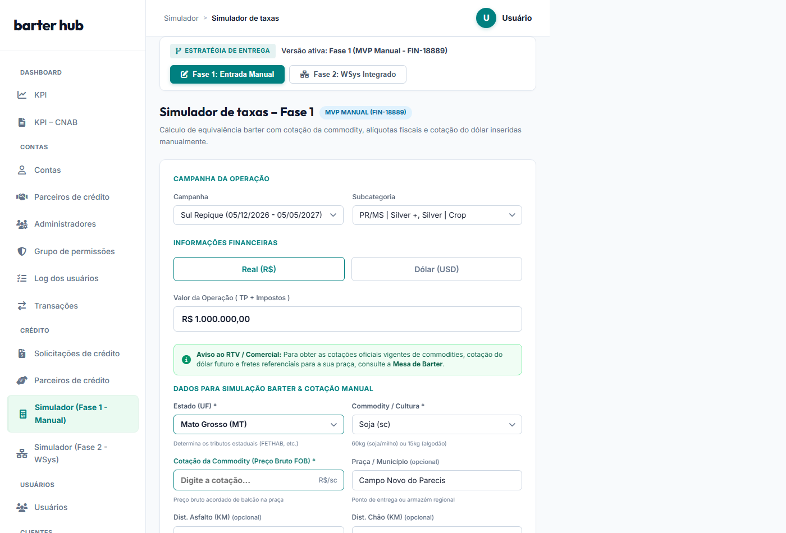
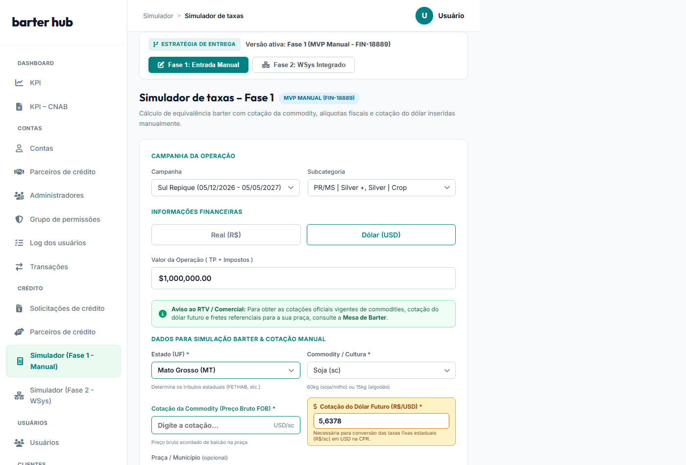
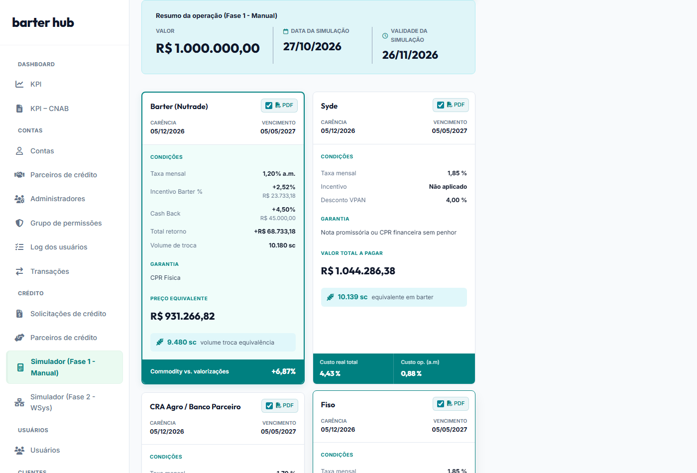

# PRD_SYDE-31 (Parte 2 de 3) – Especificação Funcional: Fase 1 (MVP Manual)
## Modalidade Barter (Nutrade) – Operação Comercial Desacoplada

* **Identificador:** PRD_SYDE-31_FASE1
* **Card Jira:** FIN-18889 (Subordinação Técnica: SYDE-31)
* **Versão:** v1.1 (Refinamento de Escopo Mínimo e Taxas – Reunião 27/10/2026)
* **Data:** 27 de outubro de 2026
* **Status:** Pronto para Desenvolvimento / Homologação (Ready for Dev)
* **Documento Pai:** [PRD_SYDE-31_Visao_Geral_Solucao.md](file:///c:/Users/jj/OneDrive/Projetos/Barter%20Simulator/PRD_SYDE-31_Visao_Geral_Solucao.md)
* **Documento Complementar:** [PRD_SYDE-31_Fase2_WSys_Integrado.md](file:///c:/Users/jj/OneDrive/Projetos/Barter%20Simulator/PRD_SYDE-31_Fase2_WSys_Integrado.md)

---

## 🎯 1. Objetivo & Justificativa de Negócio da Fase 1

O objetivo da **Fase 1 (FIN-18889)** é disponibilizar com velocidade imediata o Simulador de Barter Nutrade para os Consultores Comerciais e RTVs da Syngenta/Syde na abertura da campanha da safra 2027/28 (primeira/segunda quinzena de novembro de 2026).

### Decisões do Alinhamento Executivo (Reunião 27/10/2026):
1. **Priorização de Campo:** Leonardo Vale ressaltou que a força de vendas necessita do simulador imediatamente para atender a alta liderança e suportar a campanha 27/28 que se inicia em novembro.
2. **Posicionamento de Campos:** Definido que o **Estado (UF)** é o primeiro seletor nos dados de simulação, governando automaticamente os impostos estaduais.
3. **Foco em Soja, Milho e Algodão:** Café foi deliberadamente excluído do simulador porque o time de café da Syngenta já possui cotação automatizada direta no Salesforce.
4. **Unificação do Funrural:** Unificação do campo de Funrural em um seletor único com opções: `Comercialização (1,63%)` e `Folha de Pagamento (0,20%)`, eliminando o campo numérico redundante e o tipo "Personalizado".
5. **Automação das Taxas Estaduais:** Ao selecionar o Estado e a Cultura, o simulador carrega automaticamente:
   - Outros Impostos Base NF (%): FUNDEINFRA 1,65% (GO), FDI 1,20% (PI), 0,00% (demais).
   - Impostos Base UPF (R$/ton): FETHAB R$ 51,50/t na Soja e Algodão e R$ 14,00/t no Milho (MT); FUNDEMS R$ 27,55/t na Soja e Algodão e R$ 14,00/t no Milho (MS).
   - Dedução Fixa por Saca (R$/sc): calculada automaticamente (R$ 3,09/sc MT Soja; R$ 1,65/sc MS Soja; R$ 0,77/@ MT Algodão; R$ 0,41/@ MS Algodão).
6. **Aviso Oficial da Mesa de Barter:** Inclusão de banner com instrução mandatória para os RTVs consultarem a Mesa de Barter para obter cotações vigentes, dólar futuro e fretes.
7. **Rótulo Dólar Futuro:** O campo foi nomeado como `Cotação do Dólar Futuro (R$/USD)` para evitar que o usuário insira a taxa à vista (spot).
8. **Distâncias Rodoviárias:** `Dist. Asfalto (KM)` e `Dist. Chão (KM)` posicionadas lado a lado na mesma linha. As tarifas por km são balizadas nacionalmente.

---

## 📸 2. Telas do Protótipo Homologado (Fase 1)

### 2.1. Formulário Inicial de Simulação Manual (Moeda Real - BRL)
Na tela inicial da Fase 1, o banner oficial da Mesa de Barter orienta o comercial, o Estado (UF) aparece em primeiro lugar, a cotação da commodity inicia em branco para digitação obrigatória, os campos de distância de asfalto e chão estão lado a lado e o Funrural possui seletor unificado:



---

### 2.2. Simulação em Dólar (USD) – Exibição da Cotação do Dólar Futuro
Ao selecionar a moeda **Dólar (USD)**, o formulário exibe imediatamente o container destacado em amarelo para inserção da **Cotação do Dólar Futuro (R$/USD)**, indispensável para converter as taxas estaduais (fixadas em Reais pela lei estadual) para Dólar na CPR:



---

### 2.3. Resultados da Simulação e Comparativo Comercial (Fase 1)
Após preencher a cotação e clicar em **Simular**, o sistema renderiza o resumo executivo da operação, o volume de troca e o ranking contra as modalidades Syde, CRA Agro e Fiso (sem exibir o widget de mercado de Chicago, exclusivo da Fase 2):



---

## 📝 3. Mapeamento Detalhado dos Campos da Fase 1 (Reunião 27/10/2026)

| Campo em Tela | ID do Elemento | Tipo / Formato | Comportamento & Regra de Negócio |
|---|---|:---:|---|
| **Aviso da Mesa de Barter** | Banner visual | Informativo | Instrução clara ao RTV para consultar a Mesa de Barter a fim de obter cotações oficiais da commodity, dólar futuro e frete. |
| **Estado (UF) \*** | `v1-sim-estado` | Dropdown | **1º campo dos Dados da Simulação.** Permite escolher a UF produtora (MT, MS, GO, PI, BA, etc.), carregando automaticamente as regras fiscais estaduais. |
| **Commodity / Cultura \*** | `v1-sim-commodity` | Dropdown | Opções: `Soja (sc)`, `Milho (sc)` e `Algodão (lp)`. (Café excluído por ter cotação própria no CRM). |
| **Cotação da Commodity (FOB) \*** | `v1-sim-preco-bruto` | Numérico (`0.00`) | **Obrigatório.** Inicia em branco (`value=""`). O botão Simular bloqueia a operação caso não seja preenchido. |
| **Cotação do Dólar Futuro (R$) \*** | `v1-sim-cotacao-dolar` | Numérico (`0.0000`) | **Visível apenas se a moeda for Dólar (USD).** Rótulo explícito "Cotação do Dólar Futuro" para evitar confusão com dólar spot. Utilizado para converter taxas fixas em R$ para USD. |
| **Praça / Município (Opcional)** | `v1-sim-regiao` | Texto livre | Município de entrega (ex: `Campo Novo do Parecis`, `Dourados`, `Rio Verde`), apenas para registro visual e proposta no PDF. |
| **Distância Asfalto (KM)** | `v1-sim-dist-asfalto` | Numérico inteiro | Distância em rodovia asfaltada da fazenda até a praça de entrega. Inicia com `0`. Lado a lado com Dist. Chão. |
| **Distância Chão (KM)** | `v1-sim-dist-chao` | Numérico inteiro | Distância em estrada de terra da fazenda até o asfalto. Inicia com `0`. Lado a lado com Dist. Asfalto. |
| **Toggle Aplicar Deduções Fiscais** | `v1-sim-descontos` | Booleano (Toggle) | Padrão: **Ligado**. Permite desligar deduções fiscais para casos de pessoas jurídicas ou operações isentas de retenção. |
| **Funrural (Alíquota Unificada)** | `v1-sim-funrural` | Dropdown unificado | Opções: <br>1. `Comercialização (1,63%)` (Padrão PF - retenção sobre faturamento)<br>2. `Folha de Pagamento (0,20%)` (Opção do produtor que recolhe sobre a folha - Lei 13.606/18). |
| **Outros Impostos Base NF (%)** | `v1-sim-imposto-estadual-pct` | Read-only | Carregado automaticamente pela UF: 1,65% em GO (FUNDEINFRA); 1,20% no PI (FDI); 0,00% nos demais estados. |
| **Impostos Base UPF (R$/ton)** | `v1-sim-imposto-upf-ton` | Read-only | Valor em Reais por tonelada fixado pelo Estado (ex: MT Soja/Algodão = R$ 51,50/t; MS Soja/Algodão = R$ 27,55/t; MT/MS Milho = R$ 14,00/t; Demais = R$ 0,00/t). |
| **Dedução Fixa por Saca (R$/sc)** | `v1-sim-taxa-fixa` | Read-only | Valor retido por saca na CPR, calculado automaticamente dividindo o valor em R$/ton pelas sacas por tonelada. Ex: MT Soja = R$ 3,09/sc. |
| **Observações da Operação** | `v1-sim-obs` | Texto livre | Espaço para anotações do RTV (ex: CNPJ/CPF do titular ou fazenda entregadora). Reflete no resumo e no PDF. |

---

## 🧮 4. Explicação Clara e Passo a Passo dos Novos Cálculos

Para assegurar total transparência e fácil validação pela Mesa de Barter e Engenharia, todas as etapas estão descritas abaixo em formato aritmético direto (sem notações em LaTeX):

### Passo 1: Conversão de Impostos de R$/tonelada para R$/saca
O simulador converte a taxa estadual legislada em **R$/tonelada** para **R$/saca** dividindo pela quantidade de sacas contidas em 1 tonelada (1.000 kg):

```text
Sacas por Tonelada:
- Para Soja e Milho (sacas de 60 kg): 1.000 kg / 60 kg = 16,6667 sacas por tonelada.
- Para Algodão (sacas ou arrobas de 15 kg): 1.000 kg / 15 kg = 66,6667 sacas por tonelada.

Fórmula de Conversão:
Dedução Fixa por Saca (R$/sc) = Imposto Base UPF (R$/ton) / Sacas por Tonelada
```

**Exemplos Práticos por Estado e Cultura:**
* **Soja em Mato Grosso (MT):**
  `R$ 51,50 / 16,6667 = R$ 3,09 por saca`.
* **Milho em Mato Grosso (MT):**
  `R$ 14,00 / 16,6667 = R$ 0,84 por saca` (ou taxa específica de R$ 0,37/sc).
* **Algodão em Mato Grosso (MT):**
  `R$ 51,50 / 66,6667 = R$ 0,77 por saca/arroba`.
* **Soja em Mato Grosso do Sul (MS):**
  `R$ 27,55 / 16,6667 = R$ 1,65 por saca`.
* **Algodão em Mato Grosso do Sul (MS):**
  `R$ 27,55 / 66,6667 = R$ 0,41 por saca/arroba`.
* **Demais Estados (GO, PI, PR, BA, etc.):**
  `R$ 0,00 por saca`.

---

### Passo 2: Conversão da Taxa Fixa Estadual para Simulações em Dólar (USD)
Como a legislação estadual fixa o FETHAB e o FUNDEMS em Reais (R$), quando a simulação for em **Dólar (USD)** a taxa fixa em Reais é convertida dividindo pela cotação do dólar futuro informada:

```text
Dedução Fixa em USD = Dedução Fixa em R$ / Cotação do Dólar Futuro
```

*Exemplo Prático (Soja MT a R$ 3,09 por saca com Dólar Futuro a 5,6378):*
* `3,09 / 5,6378 = USD 0,55 por saca`.

---

### Passo 3: Apuração das Deduções Percentuais e Tributação Total
A dedução percentual aplica a alíquota combinada do Funrural e dos tributos estaduais incidentes sobre a NF sobre o Preço Bruto da commodity:

```text
Dedução Percentual por Saca = Preço Bruto * ((Funrural % + Outros Impostos Base NF %) / 100)
Dedução Total de Impostos = Dedução Percentual por Saca + Dedução Fixa por Saca
```

*Exemplo 1: Soja MT a R$ 103,00 (Funrural 1,63%, Outros NF 0,00%, FETHAB R$ 3,09):*
1. Dedução Percentual: `103,00 * 1,63% = R$ 1,68 por saca`.
2. Dedução Fixa: `R$ 3,09 por saca`.
3. Dedução Total de Impostos: `1,68 + 3,09 = R$ 4,77 por saca`.

*Exemplo 2: Soja GO a R$ 103,00 (Funrural 1,63%, FUNDEINFRA 1,65%, Taxa Fixa R$ 0,00):*
1. Dedução Percentual: `103,00 * (1,63% + 1,65%) = 103,00 * 3,28% = R$ 3,38 por saca`.
2. Dedução Fixa: `R$ 0,00 por saca`.
3. Dedução Total de Impostos: `3,38 + 0,00 = R$ 3,38 por saca`.

---

### Passo 4: Frete da Fazenda até o Polo de Entrega
```text
Custo de Deslocamento Total ($) = (Dist. Asfalto * Tarifa Asfalto) + (Dist. Chão * Tarifa Chão)
Frete Unitário por Saca = Custo de Deslocamento Total / Volume Preliminar de Sacas
```
*(Nota de alinhamento: As tarifas referenciais de frete rodoviário por KM de asfalto e chão são balizadas uniformemente a nível nacional).*

---

### Passo 5: Formação do Preço Líquido do Produtor
```text
Preço Líquido por Saca = Preço Bruto - Dedução Total de Impostos - Frete Unitário por Saca
```

---

### Passo 6: Volume de Troca e CPR Física
```text
Preço Pedido TP = Valor da Operação / (1 + Juros do Período)
Incentivo Barter ($) = Preço Pedido TP * ((Dias de Prazo / 30) * Taxa Mensal de Incentivo % / 100)
Volume de Sacas da CPR = Teto((Valor da Operação - Incentivo Barter) / Preço Líquido por Saca)
```

---

### Passo 7: Cashback Financeiro da Campanha
```text
Cashback Financeiro ($) = Valor da Operação * (Percentual de Cashback % / 100)
```
*(Creditado diretamente na conta corrente do produtor pela campanha; NÃO altera o volume de sacas da CPR).*

---

## 📅 5. Próximos Passos de Homologação e Entrega
* **Data-Alvo da Fase 1:** Primeira a segunda quinzena de Novembro de 2026, viabilizando o kickoff da campanha da safra 2027/28.
* **Validação de Mesa:** Leonardo Vale apresentará o protótipo funcional atualizado aos diretores da Syngenta na primeira semana de novembro.
