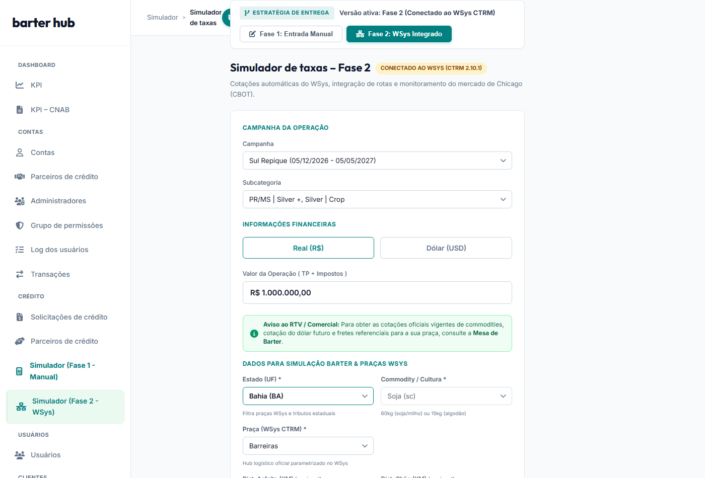
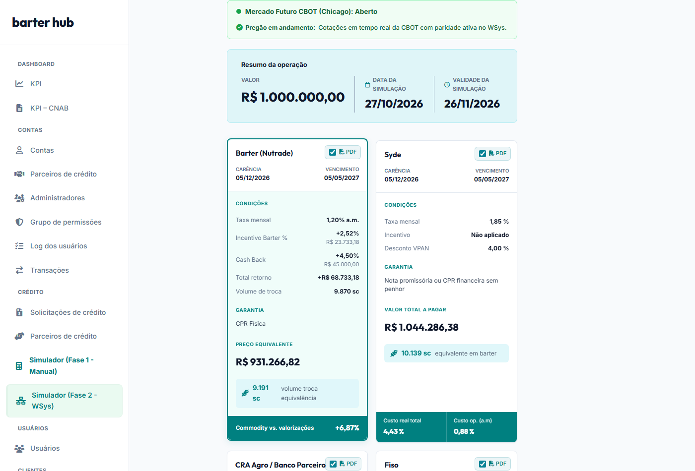
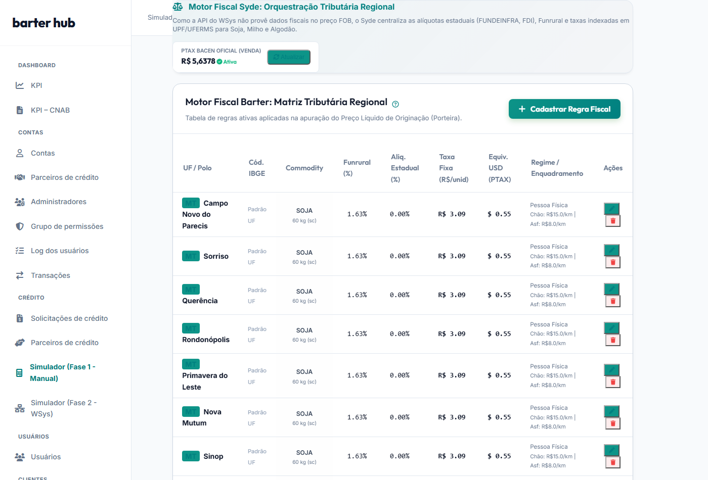

# PRD_SYDE-31 (Parte 3 de 3) – Especificação Funcional: Fase 2 (WSys Integrado)
## Modalidade Barter (Nutrade) – Automação Integral com WSys CTRM & Motor Fiscal

* **Identificador:** PRD_SYDE-31_FASE2
* **Card Jira:** SYDE-31 (Épico de Integração)
* **Versão:** v1.1 (Refinamento de Escopo Mínimo e Taxas – Reunião 27/10/2026)
* **Data:** 27 de outubro de 2026
* **Status:** Especificação Pronta para Engenharia / Backoffice
* **Documento Pai:** [PRD_SYDE-31_Visao_Geral_Solucao.md](file:///c:/Users/jj/OneDrive/Projetos/Barter%20Simulator/PRD_SYDE-31_Visao_Geral_Solucao.md)
* **Documento Complementar:** [PRD_SYDE-31_Fase1_MVP_Manual.md](file:///c:/Users/jj/OneDrive/Projetos/Barter%20Simulator/PRD_SYDE-31_Fase1_MVP_Manual.md)

---

## 🎯 1. Objetivo & Visão da Fase 2

A **Fase 2 (SYDE-31)** representa o estado da arte e a automação digital completa do fluxo de Barter na plataforma Syde, conectada diretamente ao sistema corporativo de originação da Syngenta.

### Objetivos Principais e Acordos da Reunião (27/10/2026):
1. **Conexão Direta com a Mesa Nutrade (WSys CTRM 2.10.1):** Consumo em tempo real dos preços oficiais de balcão futuro gerados pelo WSys.
2. **Cronograma de Implementação:** Conforme alinhado com Leonardo Vale, o refinamento técnico dos endpoints do WSys com o time de engenharia ocorrerá em novembro/2026, com entrega em meados/fim de dezembro de 2026 para operação plena em janeiro de 2027.
3. **Escopo de Commodities:** Foco em **Soja**, **Milho** e **Algodão**. A cultura de Café permanece fora do simulador pois o time comercial de café da Syngenta opera diretamente com cotações automáticas no Salesforce.
4. **Motor Fiscal Automático no Syde:** O RTV seleciona o **Estado (UF)** e a **Praça Polo**; o sistema aplica instantaneamente as alíquotas estaduais cadastradas (FETHAB em MT, FUNDEMS em MS, FUNDEINFRA em GO, FDI no PI e Funrural de 1,63% ou 0,20%).
5. **Conversão Cambial Automatizada via PTAX BACEN:** Para simulações em Dólar (USD), o backend consome a cotação oficial diária PTAX do Banco Central / Dólar Futuro oficial para converter as taxas estaduais fixadas em Reais.
6. **Governança de Mercado (Monitoramento CBOT & Aviso Barter):** Alerta proativo e disclaimer contratual quando a simulação ocorrer fora do pregão de Chicago, acompanhado do banner oficial da Mesa de Barter.

---

## 📸 2. Telas do Protótipo Homologado (Fase 2)

### 2.1. Formulário Integrado ao WSys (Estado, Praça e Distâncias)
Na Fase 2, o usuário seleciona a Campanha, o Estado (UF) em 1º lugar, a Cultura e a Praça Polo do catálogo WSys. A cotação é carregada automaticamente e as distâncias de asfalto e terra (chão) estão na mesma linha:



---

### 2.2. Resultados Simulados com Alerta CBOT e Gráfico de Mercado
O resultado exibe o banner informativo de status da Bolsa de Chicago (pregão aberto/fechado), cards de comparação com outras modalidades de crédito e gráfico de tendências de mercado:



---

### 2.3. Motor Fiscal do Syde (Tabela de Regras Tributárias por Praça/UF)
Módulo centralizado onde a equipe de operações e fiscal cadastra e atualiza as regras estaduais (Funrural, FETHAB, FUNDEMS, FUNDEINFRA) e monitora a Cotação PTAX:



---

## 📝 3. Mapeamento Detalhado dos Campos da Fase 2 (Reunião 27/10/2026)

| Campo em Tela | ID do Elemento | Origem dos Dados | Regra de Negócio & Automação |
|---|---|:---:|---|
| **Aviso da Mesa de Barter** | Banner visual | Informativo | Direcionamento oficial para consultar a Mesa de Barter caso necessite balizamento. |
| **Estado (UF) \*** | `v2-sim-estado` | Cadastro de Praças | **1º campo dos Dados Barter.** Filtra dinamicamente as cidades polo disponíveis no dropdown de praças WSys. |
| **Commodity / Cultura \*** | `v2-sim-commodity` | Catálogo WSys | Opções: `Soja (sc)`, `Milho (sc)` e `Algodão (lp)`. (Café excluído). |
| **Praça Logística (WSys) \*** | `v2-sim-regiao` | Catálogo Odin (`/cidades`) | Cidade homologada pela mesa. Ao selecionar a praça, o sistema aplica automaticamente a matriz fiscal e as tarifas de frete da região. |
| **Cotação da Commodity (FOB)** | `sim-preco-bruto` | API WSys (`VL_PrecoBase`) | Consumido automaticamente do endpoint `/api/integracao/odin/precos`. O RTV recebe o preço oficial homologado da mesa para a safra. |
| **Cotação do Dólar Futuro (PTAX)** | `v2-sim-cotacao-dolar` | BFF / BACEN / WSys | Cotação oficial PTAX Venda. Utilizada para converter tributos fixados em R$ (FETHAB/FUNDEMS) para simulações em USD. |
| **Distância Asfalto (KM)** | `v2-sim-dist-asfalto` | Entrada RTV (inicia em 0) | KM de rodovia da fazenda até a praça. Posicionado lado a lado com Dist. Chão. |
| **Distância Chão (KM)** | `v2-sim-dist-chao` | Entrada RTV (inicia em 0) | KM de terra da fazenda até o asfalto. Posicionado lado a lado com Dist. Asfalto. |
| **Funrural (Alíquota Unificada)** | `v2-sim-funrural` | Dropdown unificado | Opções: `Comercialização (1,63%)` (Padrão PF) ou `Folha de Pagamento (0,20%)`. |
| **Outros Impostos Base NF (%)** | Matriz Fiscal Syde | Configuração / Praça | Identificado automaticamente pela UF: 1,65% em Goiás (FUNDEINFRA); 1,20% no Piauí (FDI); 0% nos demais. |
| **Taxa Fixa Estadual (R$/ton)** | Matriz Fiscal Syde | Configuração / Praça | Puxado automaticamente por UF: MT = R$ 51,50/ton (FETHAB+IAGRO); MS = R$ 27,55/ton (FUNDEMS+FUNDERSUL). Convertido para saca conforme a cultura. |
| **Status Pregão CBOT** | Componente visual | Relógio de Mercado | Exibe badge verde quando o pregão está em andamento (10:30–15:20 e 21:00–09:45) e badge amarelo indicando preço indicativo fora de horário. |

---

## 🧮 4. Explicação dos Cálculos Automatizados da Fase 2

A lógica de cálculo da Fase 2 é idêntica à matemática financeira homologada na Fase 1, com a vantagem de **alimentar as variáveis de forma 100% automatizada**:

### 1. Formação do Preço Líquido de Originação:
```text
Preço Líquido = Preço Bruto FOB (WSys) - Dedução Total de Impostos - Frete Unitário
```

### 2. Conversão Automática de Tributos por Cultura:
O Motor Fiscal armazena o valor em **R$/tonelada** e converte automaticamente para **R$/saca** de acordo com a cultura selecionada no simulador:

```text
Dedução Fixa por Saca (R$/sc) = Valor UPF por Tonelada / Sacas por Tonelada

Onde:
- Soja e Milho (60 kg): 1.000 kg / 60 kg = 16,6667 sacas por tonelada.
  * Mato Grosso Soja: R$ 51,50 / 16,6667 = R$ 3,09 por saca.
  * Mato Grosso Milho: R$ 14,00 / 16,6667 = R$ 0,84 por saca.
  * Mato Grosso do Sul Soja: R$ 27,55 / 16,6667 = R$ 1,65 por saca.
  * Mato Grosso do Sul Milho: R$ 14,00 / 16,6667 = R$ 0,84 por saca.
- Algodão (15 kg): 1.000 kg / 15 kg = 66,6667 sacas/arrobas por tonelada.
  * Mato Grosso: R$ 51,50 / 66,6667 = R$ 0,77 por saca/arroba.
  * Mato Grosso do Sul: R$ 27,55 / 66,6667 = R$ 0,41 por saca/arroba.
- Demais UFs: R$ 0,00 por saca.
```

### 3. Conversão Cambial em USD via PTAX Oficial:
Nas simulações em Dólar, o backend aplica automaticamente a cotação oficial do Dólar Futuro / PTAX Venda:

```text
Dedução Fixa em USD = Dedução Fixa em R$ / Cotação do Dólar Futuro
```

### 4. Dedução Percentual sobre a NF:
```text
Dedução Percentual = Preço Bruto FOB * ((Funrural % + Impostos Estaduais NF %) / 100)
```

### 5. Volume Contratual de Sacas da CPR:
```text
Juros do Período = (Dias de Prazo / 360) * (Taxa Anual Barter % / 100)
Preço Pedido TP = Valor da Operação / (1 + Juros do Período)
Taxa de Incentivo (%) = (Dias de Prazo / 30) * Taxa Mensal de Incentivo (% a.m.)
Incentivo Barter ($) = Preço Pedido TP * (Taxa de Incentivo (%) / 100)

Volume de Sacas da CPR = Teto((Valor da Operação - Incentivo Barter) / Preço Líquido da Saca)
```

### 6. Cashback Financeiro da Campanha:
```text
Cashback da Campanha ($) = Valor da Operação * (Percentual de Cashback % / 100)
```
*(Valor financeiro devolvido em dinheiro ao produtor, sem alteração no volume de sacas da CPR).*

---

## 📅 5. Próximos Passos de Integração com o WSys
1. **Refinamento Técnico com Engenharia WSys (Novembro/2026):** Reuniões de detalhamento com a equipe técnica da Syngenta para validar o mapeamento de praças e contratos `/api/integracao/odin/...`.
2. **Ambiente de Homologação (Dezembro/2026):** Liberação em staging com consumo da API WSys e dados de simulação da safra 27/28.
3. **Go-Live em Produção (Janeiro/2027):** Ativação da Feature Flag `ff_barter_wsys_integration` para migração gradual da força de vendas da Fase 1 para a Fase 2.
